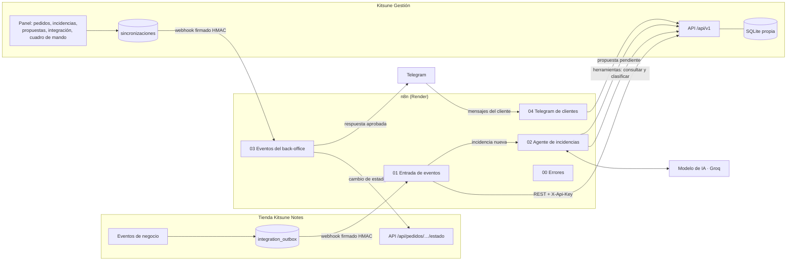

# Kitsune Notes · Tarea 2 · Integración, automatización e IA agéntica

> Prototipo académico (UCAM · Soluciones Informáticas para la Empresa). Datos ficticios,
> pagos simulados y sin actividad comercial real. Ningún secreto se guarda en este repositorio.

Esta carpeta contiene todo lo que conecta la tienda de la Tarea 1 con el back-office
**Kitsune Gestión** a través de **n8n**: los flujos exportados, los contratos de datos, los
payloads de prueba, un script para enviarlos firmados y dos simuladores para probar sin claves.

| Carpeta | Qué hay |
|---|---|
| `n8n/flujos/` | Los 5 flujos de n8n exportados (JSON importable) |
| `n8n/.env.example` | Variables de entorno del servicio n8n, sin secretos |
| `esquemas/` | Contratos de datos en JSON Schema |
| `payloads/` | Payloads de prueba de los tres escenarios y de dos casos de error |
| `scripts/enviar-evento.php` | Envía un payload a n8n firmado como lo firma la tienda |
| `simuladores/` | Modelo de IA y API de Telegram simulados, solo para pruebas locales |

El back-office está en `../backoffice` y tiene su propio README.

## 1. Arquitectura

Son tres sistemas distintos, cada uno con su almacenamiento y su acceso:

| Sistema | Dónde | Datos | Acceso |
|---|---|---|---|
| Tienda (Tarea 1) | Hosting PHP (Site.eu) | SQLite propia | Clientes; personal en `/admin`; API con `X-API-Token` |
| n8n (integración y agente) | Render, plan gratuito | PostgreSQL en Supabase (flujos, credenciales, historial) | Usuario de n8n; webhooks firmados |
| Kitsune Gestión (back-office) | Otro subdominio del hosting PHP | SQLite propia, distinta de la tienda | Usuarios propios; API con `X-Api-Key` y permisos |



### Mecanismo de intercambio

* **Tienda → n8n.** Cada evento suscrito (`cart.item_added`, `checkout.started`, `order.created`,
  `payment.simulated`, `support.requested`, `incident.created`, `order.status_changed`) se guarda en la
  bandeja de salida `integration_outbox` de la tienda (patrón *transactional outbox*). Al terminar la
  petición se envía a n8n con las cabeceras `X-Kitsune-Firma` (HMAC-SHA256 de `marca.cuerpo` con el
  secreto compartido), `X-Kitsune-Timestamp` y `X-Kitsune-Evento`. Si n8n no responde, está arrancando
  (404) o el destino falla (5xx), el evento queda **pendiente** y se reintenta con esperas de 1, 2, 5,
  15, 30, 60, 180 y 360 minutos. Si n8n lo rechaza por firma o por datos (401, 422), queda
  **rechazado**. Se ve todo en la tienda, en `/admin/integracion`.
* **n8n → back-office.** API REST (`/api/v1`) con clave `X-Api-Key`. n8n envía además
  `Idempotency-Key` (el `event_id`) y `X-Correlation-Id` (la ejecución de n8n), que quedan en el
  registro de integración.
* **Back-office → n8n → tienda.** Lo que cambia el personal (un pedido que pasa a «enviado», una
  propuesta aprobada) se guarda en la tabla `sincronizaciones` y se envía a n8n firmado. Si n8n o la
  tienda no responden, queda **pendiente de sincronización** y se reintenta. Si la tienda lo rechaza
  por una regla de negocio, queda **en conflicto** para que lo revise una persona.
* **Telegram.** n8n llama a la API de bots (`sendMessage`) y recibe los mensajes del bot por un webhook
  protegido con el `secret_token` de Telegram.

## 2. Contrato de datos

Los contratos están en `esquemas/` (JSON Schema 2020-12):

| Fichero | Qué describe |
|---|---|
| `kitsune-evento-1.schema.json` | Evento de la tienda que recibe n8n (`contrato: kitsune.evento/1`) |
| `gestion-cambio-1.schema.json` | Cambio del back-office que recibe n8n (`pedido.estado_cambiado`, `propuesta.aprobada`) |
| `propuesta-agente.schema.json` | Salida estructurada obligatoria del agente de IA |

El evento lleva el **sobre común** de la Tarea 1 (`event_id`, `event_name`, `schema_version`,
`source`, `occurred_at`, `session_id`, `actor_type`, identificadores), la carga útil `data` y un bloque
`contexto` con los datos que el back-office necesita y que los eventos no guardan por privacidad
(nombre y correo del cliente en un pedido; texto de la consulta en una incidencia). Ese bloque solo
viaja por este canal firmado.

### Validaciones (flujo 01, nodo «Verificar firma y validar»)

| Comprobación | Si falla |
|---|---|
| Firma HMAC-SHA256 sobre los bytes exactos recibidos | 401 · `firma` |
| Marca de tiempo con menos de 10 minutos de diferencia (repeticiones) | 422 · `validacion` |
| Contrato `kitsune.evento/1`, `event_id` UUID, evento suscrito, fecha ISO-8601, origen | 422 |
| `order.created`: referencia `KN-AAAA-NNNNNN`, al menos una línea, cantidades y precios enteros, moneda EUR/GBP, nombre y correo del cliente | 422 con el campo exacto |
| `payment.simulated`: referencia, resultado `autorizado`/`rechazado`, importe entero | 422 |
| `incident.created` / `support.requested`: texto de la consulta y correo del cliente | 422 |
| `order.status_changed`: referencia y estado nuevo | 422 |

Después se **transforma** al formato de la API del back-office: correos en minúsculas, SKU en
mayúsculas, unidades recalculadas a partir de las líneas, importes en céntimos y contravalor en euros.
El back-office **vuelve a validarlo todo** (defensa en profundidad): por ejemplo, rechaza un pedido cuyas
unidades no coinciden con la suma de las líneas.

### Idempotencia y orden

* El back-office no duplica nada: pedido por referencia, pago por `event_id`, incidencia por
  referencia del ticket, evento por `event_id`. Reenviar el mismo evento responde `duplicado`.
* Un pago o un cambio de estado de un pedido que el back-office aún no conoce (eventos desordenados)
  responde **503**: la tienda lo reintenta más tarde.
* Los cambios que hace la propia integración vuelven a n8n como eco (`origen: integracion`) y se
  **ignoran**, para no crear bucles.

## 3. Los flujos de n8n

| Flujo | Disparador | Qué hace |
|---|---|---|
| **01 · Entrada de eventos de la tienda** | Webhook `POST /webhook/kitsune/tienda` | Verifica la firma, valida y transforma; según el evento da de alta el pedido (escenario 1), registra el pago, crea la incidencia (escenario 3) o refleja el cambio de estado. Responde a la tienda con 200, 401, 422, 502 o 503. Guarda una copia mínima del evento para el embudo y anota el resultado. Si es una incidencia nueva, pide el análisis al agente. |
| **02 · Agente de incidencias** | Webhook interno `POST /webhook/kitsune/agente` (cabecera secreta) | Agente de IA con tres herramientas; valida su salida estructurada y la guarda como propuesta **pendiente de revisión**; avisa al equipo por Telegram. Si el modelo falla, la deja como «error del agente». |
| **03 · Eventos del back-office** | Webhook `POST /webhook/kitsune/gestion` | Cambio de estado: lo aplica en la tienda (escenario 2) y avisa al cliente por Telegram si lo tiene vinculado. Propuesta aprobada: envía al cliente por Telegram el texto aprobado o, si no tiene Telegram, la ejecuta en modo simulado. |
| **04 · Telegram de clientes** | Webhook `POST /webhook/kitsune/telegram` (`secret_token`) | `/start CÓDIGO` vincula el chat con el pedido (código firmado por la tienda); `/estado` lista sus pedidos; cualquier otro texto se añade a su incidencia abierta; `/equipo` dice el identificador del chat. |
| **00 · Errores de los flujos** | Error Trigger | Anota en el back-office cualquier ejecución fallida y avisa al equipo. |

Cada flujo tiene rama correcta, rama de error, llamada al back-office, registro del resultado
(`POST /api/v1/registro`) y aviso o tarea pendiente cuando corresponde. Todas las ejecuciones se
guardan en el historial de n8n durante 14 días.

## 4. El agente de IA

| | |
|---|---|
| Modelo | Groq, `openai/gpt-oss-120b` (variable `KITSUNE_MODELO`), por la API compatible con OpenAI |
| Herramientas de consulta | `consultar_pedido` (estado, pago, líneas, envío, `cliente_id`) y `consultar_historial_cliente` (pedidos e incidencias anteriores). Solo lectura y **sin datos de contacto** |
| Herramienta de acción | `clasificar_incidencia` (categoría y prioridad). Reversible: el equipo la cambia desde el back-office |
| Salida estructurada | `tipo_caso`, `datos_consultados`, `accion_propuesta`, `mensaje_cliente`, `justificacion`, `confianza` (0-1), `prioridad`, `riesgos`, `estado_final` |
| Límites | Clave de API propia con permisos mínimos (no puede crear propuestas ni escribir al cliente); máximo 8 pasos; acciones permitidas cerradas; el texto del cliente se trata como dato, no como instrucción |
| Supervisión humana | **Modo propuesta + revisión humana + registro de aprobación o rechazo.** La propuesta queda «pendiente de revisión» en el back-office. Una persona la aprueba (puede corregir el texto) o la rechaza con un motivo. Solo entonces n8n la envía por Telegram. Queda registrado quién, cuándo y qué se envió |
| Validación de la salida | Antes de guardarla, n8n comprueba la acción, la confianza, la prioridad, la longitud y que el mensaje no incluya correos ni teléfonos; añade riesgos si la confianza es baja o si se menciona dinero. Si no cumple, se guarda como «error del agente» |

El prompt de sistema está en el nodo «Agente de incidencias» del flujo 02.

## 5. Despliegue paso a paso

Orden recomendado: Supabase → Render (n8n) → Telegram → back-office → tienda → cron-job.org.
Genera cada secreto con `php -r "echo bin2hex(random_bytes(24)), PHP_EOL;"` y apúntalo en un sitio
privado. **Nunca** los subas a GitHub ni los pegues en un chat.

### 5.1 Base de datos de n8n (Supabase)

1. En supabase.com crea un proyecto en **Europa (Frankfurt)** con una contraseña de base de datos larga.
2. Cuando esté listo, pulsa **Connect** y elige **Session pooler** (funciona con IPv4, que es lo que usa Render).
3. Copia el host, el puerto (5432), la base de datos (`postgres`) y el usuario (`postgres.xxxxx`).

### 5.2 n8n en Render

1. En render.com: **New → Web Service → Existing image**, imagen `docker.io/n8nio/n8n:2.46.6`
   (versión fija: la que se ha probado).
2. Región **Frankfurt**, plan **Free**.
3. En **Environment**, añade las variables de `n8n/.env.example` con tus valores. `N8N_HOST`,
   `N8N_EDITOR_BASE_URL`, `N8N_WEBHOOK_URL`, `WEBHOOK_URL` y `KITSUNE_URL_N8N` llevan la dirección que te
   asigna Render (`https://NOMBRE.onrender.com`).
4. Crea el servicio. Cuando arranque, abre la dirección y crea la cuenta de propietario de n8n.
5. **Credencial del modelo:** Credentials → New → **OpenAI**. API Key: la de Groq. Base URL:
   `https://api.groq.com/openai/v1`. Nombre: `Modelo del agente (Groq, API compatible con OpenAI)`.
6. **Importa los flujos** (Workflows → Import from file), empezando por `00-errores-flujos.json`.
7. En el flujo 02, abre el nodo «Modelo del agente» y elige la credencial del paso 5.
8. En los flujos 01 a 04: **Settings → Error workflow → «Kitsune · 00 Errores de los flujos»**.
9. **Publica** los cinco flujos (botón Publish).
10. Comprueba `https://NOMBRE.onrender.com/healthz` → `{"status":"ok"}`.

### 5.3 Bot de Telegram

1. En Telegram, habla con **@BotFather** → `/newbot` → nombre `Kitsune Notes Demo` → usuario acabado en
   `bot`. Guarda el token en `KITSUNE_TELEGRAM_TOKEN` (Render).
2. Registra el webhook abriendo en el navegador (sustituye las tres partes en mayúsculas):
   `https://api.telegram.org/botTOKEN/setWebhook?url=https://NOMBRE.onrender.com/webhook/kitsune/telegram&secret_token=SECRETO_WEBHOOK`
   Debe responder `"Webhook was set"`. `SECRETO_WEBHOOK` es el valor de `KITSUNE_TELEGRAM_WEBHOOK_SECRET`.
3. Crea un grupo «Kitsune Notes · Equipo», añade el bot y escribe `/equipo`. El bot contesta con el
   identificador del chat: ponlo en `KITSUNE_TELEGRAM_CHAT_EQUIPO` (Render reinicia el servicio solo).

### 5.4 Back-office en el hosting

1. Crea el subdominio (por ejemplo `gestion-kitsune.davidalegria.eu`) con **PHP 8.4** y HTTPS.
2. Sube la carpeta `backoffice/` y apunta la raíz del subdominio a `backoffice/public`.
3. Copia `backoffice/.env.example` como `backoffice/.env` y rellénalo: `KG_APP_URL`, `KG_APP_DEBUG=0`,
   una contraseña nueva en `KG_ADMIN_PASSWORD`, `KG_CLAVE_N8N`, `KG_CLAVE_AGENTE`,
   `KG_N8N_WEBHOOK_URL=https://NOMBRE.onrender.com/webhook/kitsune/gestion` y `KG_N8N_SECRETO`.
   Por SSH, `php bin/instalar.php` crea el `.env` con claves aleatorias si no existe.
4. La carpeta `backoffice/storage` debe poder escribirse (ahí está la base de datos).
5. Comprueba `https://gestion-kitsune.davidalegria.eu/api/v1/salud` → `"n8n": "configurado"`.

### 5.5 Tienda

1. Actualiza el código de la tienda con los cambios de la Tarea 2.
2. Añade al `.env` de la tienda: `KN_WEBHOOK_URL=https://NOMBRE.onrender.com/webhook/kitsune/tienda`,
   `KN_WEBHOOK_SECRET`, `KN_TELEGRAM_BOT` (el usuario del bot, sin @) y `KN_TELEGRAM_LINK_SECRET`.
3. La tabla `integration_outbox` se crea sola en la primera visita. En `/admin/integracion` se ven los envíos.

### 5.6 Que Render no se duerma (cron-job.org)

El plan gratuito de Render se duerme tras 15 minutos sin tráfico y tarda alrededor de un minuto en
despertar. En cron-job.org crea una tarea que abra `https://NOMBRE.onrender.com/healthz` cada 10 minutos.
Aunque se duerma, no se pierde nada: la tienda y el back-office reintentan solos.

Opcional, si el hosting tiene tareas programadas: `php RUTA/tienda/bin/despachar-webhooks.php` y
`php RUTA/backoffice/bin/reintentar-sincronizaciones.php` cada 5 minutos.

### 5.7 Correspondencia de secretos

| Secreto | Tienda (.env) | n8n (Render) | Back-office (.env) |
|---|---|---|---|
| Firma de los eventos de la tienda | `KN_WEBHOOK_SECRET` | `KITSUNE_SECRETO_TIENDA` | — |
| Token de la API de la tienda | `KN_API_TOKEN` | `KITSUNE_TOKEN_TIENDA` | — |
| Enlace de Telegram del pedido | `KN_TELEGRAM_LINK_SECRET` | `KITSUNE_SECRETO_TELEGRAM` | — |
| Clave de integración | — | `KITSUNE_CLAVE_GESTION` | `KG_CLAVE_N8N` |
| Clave del agente | — | `KITSUNE_CLAVE_AGENTE` | `KG_CLAVE_AGENTE` |
| Firma de los cambios del back-office | — | `KITSUNE_SECRETO_GESTION` | `KG_N8N_SECRETO` |
| Llamada interna al agente | — | `KITSUNE_SECRETO_AGENTE` | — |
| Webhook de Telegram | — | `KITSUNE_TELEGRAM_WEBHOOK_SECRET` | — |
| Token del bot | — | `KITSUNE_TELEGRAM_TOKEN` | — |
| API key de Groq | — | Credencial de n8n | — |

## 6. Comprobación y demostración

1. **Escenario 1.** Compra en la tienda (primero con la tarjeta de rechazo `4000 0000 0000 0002` y
   después con `4242 4242 4242 4242`). En segundos el pedido aparece en Kitsune Gestión → Pedidos, con
   líneas, cliente, importe, estado y los dos intentos de pago.
2. **Escenario 2.** En la ficha del pedido del back-office, márcalo «En preparación» y después «Enviado»
   (con transportista y seguimiento). La tienda refleja el estado, el cliente recibe el aviso y, si
   tiene Telegram vinculado, un mensaje. Si n8n está caído, el cambio queda pendiente y se reintenta.
3. **Escenario 3.** En la página del pedido pulsa «Abrir en Telegram» y después «Iniciar». Abre una
   incidencia desde la tienda. En el back-office aparece la incidencia y, en unos segundos, la propuesta
   del agente; el grupo del equipo recibe el aviso. Apruébala (puedes corregir el texto): el cliente la
   recibe en Telegram. Si contesta por Telegram, su mensaje se añade a la incidencia.
4. **Errores.** Envía un payload incorrecto:
   `php integracion/scripts/enviar-evento.php integracion/payloads/error-pedido-sin-lineas.json https://NOMBRE.onrender.com/webhook/kitsune/tienda SECRETO_TIENDA --nuevo`
   → 422, la ejecución queda en n8n, el error en Kitsune Gestión → Integración y el aviso en Telegram.
5. **Cuadro de mando.** Kitsune Gestión → Cuadro de mando.

### Payloads de prueba

| Fichero | Escenario | Se envía a |
|---|---|---|
| `escenario-1-pedido-creado.json` | 1 · pedido generado | `/webhook/kitsune/tienda` (secreto de la tienda) |
| `escenario-2-cambio-de-estado.json` | 2 · cambio operativo | `/webhook/kitsune/gestion` (secreto del back-office) |
| `escenario-3-incidencia-creada.json` | 3 · incidencia | `/webhook/kitsune/tienda` |
| `escenario-3-propuesta-aprobada.json` | 3 · respuesta aprobada | `/webhook/kitsune/gestion` |
| `error-pedido-sin-lineas.json` | Error de validación (422) | `/webhook/kitsune/tienda` |
| `error-pago-de-pedido-desconocido.json` | Evento desordenado (503) | `/webhook/kitsune/tienda` |

Son payloads reales generados por el prototipo durante las pruebas, con datos ficticios.

## 7. Errores y dónde quedan registrados

| Situación | Respuesta | Dónde se ve |
|---|---|---|
| Firma incorrecta | 401, no toca el back-office | Historial de n8n, Integración (registro), aviso al equipo |
| Datos incompletos | 422 con el campo que falla | Igual; la tienda lo marca «rechazado» |
| Pago de un pedido aún no recibido | 503, la tienda reintenta | Registro (`orden_eventos`) |
| Back-office caído o con error | 502, la tienda reintenta | Registro, bandeja de la tienda «pendiente» |
| n8n dormido o caído | Sin respuesta | Bandejas «pendiente» en la tienda y en el back-office |
| La tienda rechaza un cambio de estado | 409 | Back-office: sincronización «en conflicto» |
| El modelo de IA falla | Propuesta «error del agente» | Back-office, registro (`agente`), aviso |
| Telegram rechaza el envío | 409 | Propuesta «fallo al ejecutar» |
| Fallo inesperado en cualquier flujo | Flujo 00 | Registro (`fallo_flujo`), aviso al equipo |

## 8. Probar en local sin claves

Los simuladores sustituyen a Groq y a Telegram para probar todo el circuito en un ordenador:

```bash
python3 integracion/simuladores/llm_simulado.py 8300 llm.jsonl
python3 integracion/simuladores/telegram_simulado.py 8400 telegram.jsonl
```

En n8n local: credencial OpenAI con Base URL `http://localhost:8300/v1` y `KITSUNE_TELEGRAM_API=http://localhost:8400`.
El simulador del modelo no razona: llama a las herramientas en orden y devuelve una propuesta fija.
Solo sirve para comprobar el cableado; el agente real usa Groq.

## 9. Seguridad y privacidad

* Secretos solo en variables de entorno (Render) y en los `.env` de cada sistema; los flujos exportados
  no contienen ninguno.
* Firmas HMAC-SHA256 con marca de tiempo en los dos webhooks de entrada; `secret_token` en el de
  Telegram; código firmado en el enlace que vincula Telegram con un pedido.
* Mínimo privilegio: dos claves de API con permisos distintos; el agente no ve correos ni teléfonos.
* Minimización: de Telegram solo se guarda el identificador del chat.
* Datos de prueba ficticios (`*.test`). Los chats de Telegram de la demo son de los miembros del equipo.

## 10. Limitaciones conocidas

* Render gratuito se duerme y tarda alrededor de un minuto en despertar; Supabase pausa los proyectos
  gratuitos tras una semana sin actividad.
* El plan gratuito de Groq limita a 8.000 tokens por minuto y una ejecución del agente usa cerca de
  ese máximo; si se supera, el modelo reintenta respetando la espera que indica Groq. Groq es un
  servicio de fuera de la UE: con datos reales habría que revisar el encargo de tratamiento (RGPD);
  aquí todos los datos son ficticios.
* Las métricas se calculan con los datos del back-office; no hay almacén de datos aparte.
* La tienda y el back-office comparten hosting, pero no código, base de datos ni usuarios.
